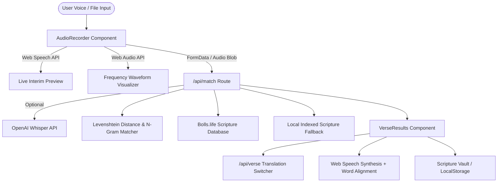

<div align="center">

# 📖 VerseFinder

**Intelligent Voice-to-Scripture Identification & Reference Engine**

*Like Shazam for music, but engineered for the Bible.*

[](https://nextjs.org/)
[](https://react.dev/)
[](https://www.typescriptlang.org/)
[](https://tailwindcss.com/)
[](https://ui.shadcn.com/)
[](https://web.dev/progressive-web-apps/)

<br />

[Features](#-key-features) • [Architecture](#-architecture--tech-stack) • [Getting Started](#-getting-started) • [API Documentation](#-api-endpoints) • [Project Structure](#-project-structure)

</div>

---

## 🌟 Overview

**VerseFinder** is a modern, high-performance web application designed to instantly recognize, retrieve, and cross-reference Bible scriptures from live speech or pre-recorded audio. 

Whether you are listening to a sermon, studying in a small group, or recalling a half-remembered verse, VerseFinder transforms spoken words into precise scripture references across the 66 canonical books of the Bible in real time.

---

## ✨ Key Features

### 🎙️ Real-Time Voice Recognition & Audio Processing
- **Live Frequency Waveform:** Real-time Web Audio API (`AudioContext` + `AnalyserNode`) visualizer rendering live vocal dynamics as you speak.
- **Adaptive In-Browser Speech Recognition:** Native Web Speech API integration provides real-time interim speech previews.
- **Cross-Browser Audio Codec Negotiation:** Automatically detects and negotiates optimal recording formats (`audio/webm;codecs=opus`, `audio/ogg`, `audio/mp4`, `audio/wav`).
- **Audio File Uploads:** Upload pre-recorded audio files (`.mp3`, `.wav`, `.m4a`, `.webm`) for batch or offline recognition.
- **Server-Side Whisper AI Integration:** Optional server-side transcription powered by OpenAI Whisper (`whisper-1`) when configured via environment variables.

### 🔍 Intelligent Scripture Matching & Ranking
- **Strict 66-Book Canonical Alignment:** Scoped strictly to the 66 canonical books of the Bible (39 Old Testament + 27 New Testament), eliminating apocryphal and spurious matches.
- **Ranked Multi-Candidate Results:** Returns the top 3–5 candidate verses ranked by confidence percentage (0–100%), allowing quick selection when transcriptions are ambiguous.
- **Fuzzy Search & Phonetic Matching:** Employs Levenshtein distance edit algorithms and n-gram scoring to gracefully handle slight transcription errors, homophones, or missing words.
- **Keyword Fallback Strategy:** Automatically extracts high-entropy keywords when full-sentence queries fail, ensuring consistent resolution.

### 🔄 Dynamic Multi-Translation Switcher
- Switch translation perspectives on the fly without re-running searches.
- Supported translations include:
  - **KJV** (King James Version)
  - **NIV** (New International Version)
  - **ESV** (English Standard Version)
  - **NASB** (New American Standard Bible)
  - **NLT** (New Living Translation)
  - **WEB** (World English Bible)
  - **YLT** (Young’s Literal Translation)

### 🔊 Text-to-Speech & Word-by-Word Alignment
- **Listen to Verse:** Built-in speech synthesis featuring calm, reverent voice selection (`rate: 0.88`).
- **Karaoke-Style Word Highlighting:** Real-time audio boundary tracking that highlights each word in the verse text synchronously as it is spoken.

### 📚 Scripture Vault (Favorites & History)
- **Local Persistence:** Bookmarks and recent searches automatically sync to `localStorage`.
- **Slide-Out Drawer:** Convenient slide-out sheet (`HistoryDrawer`) to view, manage, search, and recall previously identified scriptures.
- **One-Click Actions:** Copy with formatted citation, or share directly using the native Web Share API with safe clipboard fallbacks.

### 📱 Progressive Web App (PWA)
- Installable on mobile devices (iOS / Android) and desktop as a standalone app.
- Includes Web App Manifest and offline-resilient architecture with development safety shields.

---

## 🏗️ Architecture & Tech Stack



### Core Technologies

| Layer | Technologies |
| :--- | :--- |
| **Framework** | [Next.js 14](https://nextjs.org/) (App Router, Server Actions, API Routes) |
| **Language** | [TypeScript 5](https://www.typescriptlang.org/) |
| **UI & Styling** | [Tailwind CSS](https://tailwindcss.com/), [shadcn/ui](https://ui.shadcn.com/), [Radix UI](https://www.radix-ui.com/) |
| **Icons & Animation** | [Lucide React](https://lucide.dev/), `tailwindcss-animate` |
| **Notifications** | [Sonner](https://sonner.emilkowal.ski/), Radix Toast |
| **Audio & Speech** | Web Audio API, Web Speech API (`SpeechRecognition`, `SpeechSynthesis`), HTML5 `MediaRecorder` |
| **State & Storage** | React State, Custom Event Storage Bus, `localStorage` |

---

## 🚀 Getting Started

### Prerequisites

- **Node.js:** v18.17.0 or later (v20.x recommended)
- **Package Manager:** `npm`, `pnpm`, or `yarn`

### Installation

1. **Clone the repository:**
   ```bash
   git clone https://github.com/your-username/verse-whisper-finder.git
   cd verse-whisper-finder
   ```

2. **Install project dependencies:**
   ```bash
   npm install
   ```

3. **Configure Environment Variables (Optional):**
   Create a `.env.local` file in the root directory if you wish to enable server-side OpenAI Whisper transcription for browsers without native Web Speech API support:
   ```env
   OPENAI_API_KEY=your_openai_api_key_here
   ```

4. **Launch the development server:**
   ```bash
   npm run dev
   ```
   Open [http://localhost:3000](http://localhost:3000) in your web browser.

---

## 📡 API Endpoints

### 1. Match Scripture
`POST /api/match`

Accepts multipart form data with an audio file and/or a transcript string.

- **Request Payload (`multipart/form-data`):**
  - `transcript` *(string, optional)*: Raw transcript from speech recognition or text search.
  - `audio` *(File, optional)*: Audio recording blob (`.webm`, `.ogg`, `.mp4`, `.wav`, `.mp3`).

- **Response (`application/json`):**
  ```json
  {
    "success": true,
    "transcript": "the Lord is my shepherd",
    "match": {
      "reference": "Psalm 23:1",
      "text": "The LORD is my shepherd; I shall not want.",
      "chapter": "Psalm 23",
      "context": "Identified using full-text scripture indexing for \"the Lord is my shepherd\"",
      "theme": "Scripture Database Match",
      "confidence": 100
    },
    "matches": [
      {
        "reference": "Psalm 23:1",
        "text": "The LORD is my shepherd; I shall not want.",
        "chapter": "Psalm 23",
        "confidence": 100
      },
      {
        "reference": "Psalm 27:1",
        "text": "The LORD is my light and my salvation...",
        "chapter": "Psalm 27",
        "confidence": 79
      }
    ]
  }
  ```

### 2. Fetch Translation
`GET /api/verse?reference={reference}&translation={translation}`

Retrieves the text of a specific canonical verse in the chosen translation.

- **Query Parameters:**
  - `reference`: Formatted reference (e.g. `John 3:16`, `Psalm 23:1`).
  - `translation`: Translation code (`KJV`, `NIV`, `ESV`, `NASB`, `NLT`, `WEB`, `YLT`).

- **Response (`application/json`):**
  ```json
  {
    "success": true,
    "reference": "John 3:16",
    "translation": "ESV",
    "text": "For God so loved the world, that he gave his only Son, that whoever believes in him should not perish but have eternal life."
  }
  ```

---

## 📂 Project Structure

```text
verse-whisper-finder/
├── public/
│   ├── icon.svg               # Application favicon and vector icon
│   ├── manifest.json          # Web App Manifest for PWA installation
│   └── sw.js                  # PWA service worker with dev safeguards
├── src/
│   ├── app/
│   │   ├── api/
│   │   │   ├── match/         # POST /api/match (matching & ranking engine)
│   │   │   └── verse/         # GET /api/verse (multi-translation retrieval)
│   │   ├── error.tsx          # Client runtime error boundary
│   │   ├── global-error.tsx   # Root layout error boundary
│   │   ├── layout.tsx         # Root layout with providers & theme setup
│   │   ├── page.tsx           # Main application view & state coordinator
│   │   └── providers.tsx      # Theme and QueryClient providers
│   ├── assets/
│   │   └── hero-image.jpg     # Hero banner background graphic
│   ├── components/
│   │   ├── ui/                # Radix + Tailwind primitive components (shadcn)
│   │   ├── AudioRecorder.tsx  # MediaRecorder & Web Audio API visualizer
│   │   ├── Header.tsx         # Navigation header & theme toggle
│   │   ├── HeroSection.tsx    # Landing intro, stats & call-to-actions
│   │   ├── HistoryDrawer.tsx  # Slide-out drawer for favorites & history
│   │   ├── ServiceWorkerRegister.tsx # PWA install prompt & registration
│   │   ├── ThemeToggle.tsx    # Light/Dark mode toggler with hydration protection
│   │   └── VerseResults.tsx   # Ranked results card, TTS & translation switcher
│   ├── hooks/
│   │   ├── use-mobile.tsx     # Responsive viewport breakpoint hook
│   │   └── use-toast.ts       # Imperative toast trigger hook
│   └── lib/
│       ├── bible-books.ts     # 66 canonical Bible books definitions & mappings
│       ├── bible-data.ts      # Core popular verses baseline index
│       ├── matcher.ts         # Fuzzy Levenshtein & n-gram ranking algorithms
│       ├── storage.ts         # LocalStorage persistence for vault & history
│       └── utils.ts           # Tailwind CSS class merging helper (cn)
├── next.config.mjs            # Next.js compiler & cache headers configuration
├── package.json               # Project manifest & script declarations
├── tailwind.config.ts         # Tailwind theme & design token configuration
└── tsconfig.json              # TypeScript compilation settings
```

---

## 🛠️ Scripts Reference

| Command | Description |
| :--- | :--- |
| `npm run dev` | Starts local Next.js development server at `http://127.0.0.1:3000` |
| `npm run build` | Compiles optimized production build into `.next/` |
| `npm run start` | Serves the production build locally |
| `npm run lint` | Runs ESLint analysis across TypeScript/React files |

---

## 🔒 Content & Canon Integrity

VerseFinder strictly adheres to the 66-book Protestant canon (Genesis through Revelation). Public-domain and permissible APIs are leveraged for scripture retrieval, and automated fallback layers guarantee that results remain faithful to the spoken passage.

---

## 📄 License

This project is open-source and available under the [MIT License](LICENSE).
